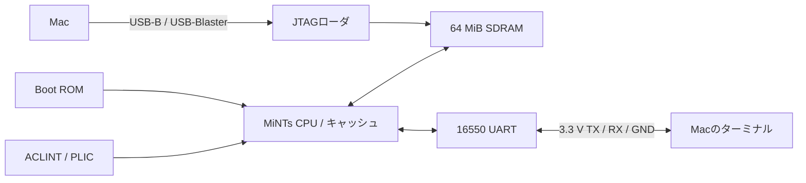

# DE0-CVでLinuxとBusyBoxを動かす

MiNTs-CPUをDE0-CVへ実装し、MacからUART経由でLinuxのシェルを操作するためのガイドです。
Apple M1 Macでビルドし、DE0-CV実機でLinux 6.12とBusyBoxの起動・継続したコマンド操作を確認した構成を説明します。

## 動作確認済みの構成

| 項目 | 構成 |
|---|---|
| ボード | Terasic DE0-CV、Cyclone V 5CEBA4F23C7N |
| CPU | MiNTs RV64IMAC、M/S/Uモード、Sv39 MMU、PMP |
| CPUクロック | 20 MHz |
| メモリ | オンボードSDRAM 64 MiB |
| I/Dキャッシュ | 各1 KiB（32 B × 32ライン）、データ配列はM10K |
| D-cache書き込み | Write-through、4エントリのStore Buffer |
| TLB | 命令側・データ側それぞれ2エントリ |
| 分岐予測 | 無効 |
| 割り込み | ACLINT MSWI/MTIMER、PLIC |
| UART | NS16550互換、115200 baud、8N1、フロー制御なし |
| ファームウェア | OpenSBI v1.3.1、`fw_jump` |
| OS / ユーザーランド | Linux 6.12、BusyBox 1.36.1、組み込みinitramfs |
| Linux時計源 | `riscv_clocksource` |
| Linux周期割り込み | `CONFIG_HZ=100`、周期動作、NO_HZ/HIGH_RES_TIMERS無効 |
| GPIO | スイッチ10個・ボタン4個の入力、LED10個の表示切り替え、Linux UIO経由 |
| 実機診断 | 読み取り専用JTAG CPUスナップショットを有効化 |

**20 MHzはCPUとハードウェアタイマーのクロック、100 HzはLinuxの周期割り込み頻度です。**
現在はCPU・SDRAM制御・ACLINTが同じ20 MHzで動作し、`mtime`は1クロックごとに増加します。
100 Hzの設定はCPUを低速化するものではありません。`clocksource=jiffies`の起動指定も使用しません。
20 MHz以外へ変更する場合は、PLL・SDC・SDRAMの待ち時間・UART生成パラメータ・Device Treeを整合させ、配置配線と実機確認をやり直します。

## 全体構成



FPGA回路とLinuxイメージは別々に転送します。

1. `.rbf`でFPGAのSRAMを設定し、CPU・SDRAM制御・UART・ローダの回路を作ります。CPUはリセット状態で待機します。
2. JTAGローダがSDRAM全64 MiBをクリアし、OpenSBI・Linux・Device Treeを転送します。
3. **イメージの全ワードを読み戻して一致した場合だけ**CPUを起動します。
4. Boot ROM → OpenSBI → Linux → `/init` → BusyBoxシェルの順に進みます。

構成Flashへの書き込みは行いません。電源を切ると回路設定とSDRAM内容が消えるため、次回は両方を転送し直します。

## アドレス配置

| 用途 | アドレス |
|---|---|
| SDRAM全体 | `0x80000000`〜`0x83ffffff`（64 MiB） |
| OpenSBIのロード先 | `0x80000000` |
| Linuxの開始位置 | `0x80200000` |
| OpenSBIによるDTBコピー先 | `0x82200000`（RAMイメージ生成時に64 KiBを予約） |
| DTBの転送先 | `0x83f00000` |
| GPIO（8 Bレジスタ） | `0x40000000` |
| UART | `0x10000000` |
| ACLINT | `0x02000000` |
| PLIC | `0x0c000000` |

Boot ROMは`a0=0`、`a1=0x83f00000`でOpenSBIへ進みます。
OpenSBIはLinuxへ移行する際、DTBをコピーし、そのアドレスを渡します。
Device Treeは`platform/riscv_cpu_de0cv64.dts`、容量と配置の設定はMakefileの`de0cv64`プロファイルにあります。

## 配線

USB-Blaster用USB-Bは回路設定・JTAG転送に使います。Linuxの入出力には別途3.3 V USB-UARTアダプタが必要です。
配線の変更はボードの電源を切って行ってください。

| DE0-CV JP1 | FPGA信号 | USB-UART側 |
|---|---|---|
| 8 | TXD出力、PIN_K22 | RXD |
| 10 | RXD入力、PIN_M21 | TXD |
| 12 | GND | GND |

アダプタの電源線やJP1-11（5 V）は接続せず、TX/RX/GNDのみ接続します。
既存のUART単体回路と同じ配線です。[UART配線の詳細](../uart_echo/README.md#wiring-power-off-while-wiring)も参照できます。

## M1 Macのビルド環境

リポジトリのルートでコマンドを実行します。Docker Desktopを起動し、Mac側にはXcode Command Line Toolsを用意してください。

| 処理 | 実行場所 |
|---|---|
| Linux・OpenSBI・BusyBoxのビルド | ARM64 Linux Docker、`Dockerfile.linux` |
| Quartus Prime Lite 20.1 | x86_64 Linux Docker、`Dockerfile.quartus` |
| USB-Blasterへの転送 | MacネイティブのopenFPGALoaderとJTAGホストツール |
| UARTターミナル | Macの`screen`など |

Quartus用には以下の公式Linuxインストーラを`~/Downloads`へ用意します。
取得先とチェックサムは[Quartus環境セットアップ](../blink/QUARTUS_M1_SETUP.md)にあります。

- `QuartusLiteSetup-20.1.0.711-linux.run`
- `cyclonev-20.1.0.711.qdz`

```sh
# Quartusのインストール（初回。公式インストーラのEULAに同意して実行）
bash tools/setup-quartus.sh

# Mac側のUSB-Blaster転送ツールとJTAGローダ（初回）
bash tools/setup-de0cv-programmer.sh
bash tools/build-de0cv-jtag-load.sh
```

QuartusはDocker volume `mints-quartus-20.1`へ入ります。
Linuxソースとコンパイラのビルド途中ファイルは`mints-linux-sources`へ保存します。
生成物は`build/`、Mac用ツールとインストーラは`local/`に置かれ、いずれもGit管理外です。
Gitのクローンだけでは公式インストーラやビルド済みイメージは復元されません。

## ビルド

### Linuxイメージ

```sh
PLATFORM_PROFILE=de0cv64 bash tools/rebuild-linux.sh all
```

ソース取得、ツールチェーン、OpenSBI、BusyBox、Linux、RAMイメージを生成します。
`de0cv64`は対話シェルを標準とし、`platform/linux_de0cv.fragment`を適用します。
この処理ではFPGAへの転送を行いません。

依存物がすでにある場合は、カーネルとRAMイメージだけを再生成できます。

```sh
PLATFORM_PROFILE=de0cv64 bash tools/rebuild-linux.sh kernel
PLATFORM_PROFILE=de0cv64 bash tools/rebuild-linux.sh image
```

### FPGA回路

```sh
STAGE=asm bash tools/build-de0cv-soc.sh
```

合成・配置配線・タイミング解析・アセンブル・全コーナーとピンの検査を実施し、`.sof`と転送用`.rbf`を生成します。
デフォルトは上記の動作確認済み構成で、FitterのAggressive Routability Optimizationは`ALWAYS`です。
既存の同名ビルドは`build/fpga/archive/`へ退避されます。

| 生成物 | パス |
|---|---|
| FPGA転送用回路 | `build/fpga/de0cv-soc/quartus/output_files/de0cv_soc.rbf` |
| 検査結果 | `build/fpga/de0cv-soc/signoff.txt` |
| Linux RAMイメージ | `build/platform/de0cv64/opensbi_ram.hex` |
| Device Tree | `build/platform/de0cv64/riscv_cpu.dtb` |
| Linux Image | `build/external/linux-out/Image-linux-6.12-riscv64-busybox-default-initramfs-de0cv64` |
| Linux設定・シンボル | `build/linux-build-busybox-default-de0cv64/` |

`PLATFORM_PROFILE`未指定のLinuxビルドは従来のシミュレータ用`legacy`構成です。
RAM容量・DTB・カーネル設定が異なるため、実機用には`de0cv64`を指定してください。

## 実機への転送と起動

ボードの電源を入れ、USB-BとUSB-UARTをMacへ接続します。
別のターミナルでUARTを先に開きます。デバイス名は各Macで確認してください。

```sh
ls /dev/tty.usbserial-*
screen /dev/tty.usbserial-XXXX 115200
```

もう一方のターミナルで次を実行します。

```sh
bash tools/program-de0cv-soc.sh
local/fpga-tools/bin/de0cv-jtag-load load-run build/platform/de0cv64/opensbi_ram.hex
```

転送ツールは検査済みビルドのハッシュとFPGAのIDを確認します。
ローダの表示は`clear all RAM` → `write` → `verify` → `CPU released`の順です。
約49.7万ワードの今回のイメージでは、RAM転送・照合・CPU起動まで約5分でした。容量と環境で変わります。

UARTにはOpenSBI、Linuxのログに続いて以下が表示されます。カーネル初期化にも数分かかる場合があります。

```text
BusyBox userspace on SystemVerilog RISC-V CPU
Type commands. Example: uname -a
~ #
```

`load`と`release`を別々に実行することもできます。`release`は再度全イメージを照合します。
`load-run`は同一プロセスで転送・照合・CPU起動まで行います。
CPU起動後の再ロードには、最初の`program-de0cv-soc.sh`からやり直してください。ウォームリセットはありません。

## シェルでの確認

以下はLinuxの`~ #`プロンプトへ1行ずつ入力します。Mac側へ入力するコマンドではありません。

```sh
uname -a
cat /sys/devices/system/clocksource/clocksource0/current_clocksource
cat /proc/interrupts
cat /proc/uptime
echo hello >/tmp/probe
cat /tmp/probe
rm /tmp/probe
/bin/busybox dd if=/dev/zero of=/dev/null bs=4096 count=256
sleep 2; echo SLEEP_OK
```

時計源は`riscv_clocksource`、ファイルの内容は`hello`、最後は`SLEEP_OK`となることを確認します。
`/proc/interrupts`の`riscv-timer`は時間とともに増えます。
`dd`は1 MiBのゼロデータを読み出して破棄する負荷確認であり、SDRAM全領域のテストではありません。
initramfsに`dd`のリンクがなくても実行できるよう、`/bin/busybox dd`と指定しています。
大量の貼り付けはUARTの受信バッファを超える場合があるため、コマンドごとの応答を待ってください。

## 独自Cアプリ：ライフゲーム

標準のLinux再ビルドでは、RV64IMAC/LP64で静的リンクした`/bin/life`もinitramfsへ組み込みます。
Linuxシェルから実行します。

```sh
life --self-test
life --demo 40
life --bench 100
```

デモは32×16の盤面をUARTへ表示します。ベンチマークは盤面を表示せず、世代更新の実時間と
チェックサムを出力します。100世代の期待値は`9b6d74a5221ad510`です。
ハードウェアのサイクル数やCPIではなく、OSの割り込みなども含む経過時間を測ります。
ビルド手順と測定条件は[アプリの説明](../../../examples/life/README.md)を参照してください。

## Linuxから基板を操作する

GPIO版の回路とLinuxでは、`/dev/uio0`経由でLED表示と入力状態を扱えます。
既存のUART配線以外に外部の配線は不要です。Linuxシェルから実行します。

```sh
boardctl status
boardctl self-test
boardctl leds 0x155
boardctl diagnostics
life --board 40
```

`leds`はアプリ表示へ切り替え、`diagnostics`で通常の診断表示へ戻します。
ライフゲームのボードモードでは、SW0=1で一時停止、SW0=0で再開、KEY0で世界と世代数を初期化します。
LEDは世代数の下位10 bitを表示し、終了時は実行前のLED状態へ戻します。KEY0はLinuxのリセットではありません。
メモリ・ローダ・UARTの異常を示すLED5〜8は、アプリ表示中も異常時に点灯します。

実機ではUIO認識、LEDレジスタの書き込み・読み戻し、GPIO連携モードの4世代完走とチェックサム、
終了後の診断表示復元を確認しました。物理スイッチを手で切り替える操作とLEDの目視確認は、今回の自動テストには含みません。
停止・再開・ボタン初期化・中断時の復元は、別途ホスト上の入力模擬テストで確認しています。

レジスタ仕様・所有権・入力の同期とボタン処理は[GPIOアプリの説明](../../../examples/boardctl/README.md)を参照してください。
`/dev/mem`は使わず、ボード用カーネルのUIOとDevice Treeを使用します。

## 検証済みの範囲と制約

- M1 Macで生成した回路をDE0-CVへ転送し、通常時計源でLinuxと対話シェルを起動しました。
- 継続したUART操作、CPUループ、ファイル作成・読み戻し・削除、1 MiBのゼロデータ処理、`sleep`、30秒待機後の操作を確認しました。
- 短時間の比較ではLinuxの21.96秒に対しMac側で21.92秒経過しました。精密な時計校正ではありません。
- 回路は17,049 / 18,480 ALM（92%）、レジスタ13,742、RAMブロック55個です。20 MHzで全4コーナーのsetup/hold/recovery/removalと66ピンの検査を通過し、最悪setup slackは+3.750 nsでした。
- 試した250 Hz構成では応答停止が残り、正常動作を確認できていません。通常時計源で操作を確認できた100 Hz構成を標準としています。長時間の連続運転や一般的なLinuxディストリビューション全体の動作は未検証です。
- `/tmp`とルートファイルシステムはRAM上です。ファイルを永続保存するストレージはこの構成に含みません。

設定と依存ソースのバージョンはスクリプトで指定していますが、Docker・パッケージ配布元・ビルド日時などによりバイナリの完全一致は保証しません。
タイミング検査と実機の確認を、再ビルドした生成物に対して実施してください。

## LEDと問題の切り分け

以下は診断表示モードの割り当てです。アプリ表示から戻す場合は`boardctl diagnostics`を実行します。

| LEDR | 意味 |
|---|---|
| 0 | ハートビート |
| 1 | PLL lock |
| 2 | RAMクリア完了 |
| 3 | CPU起動済み |
| 4 | SDRAM初期化完了 |
| 5 / 6 | メモリアクセス異常 / ローダ異常 |
| 7 / 8 | UART TX overflow / RX overrun |
| 9 | CPUの`led[0]`出力 |

- **USB-Blasterが見つからない:** 電源、USB-B端子、データ通信対応ケーブルを確認します。UART用USBとは別です。
- **照合不一致:** CPUは起動されません。FPGAを再設定し、再転送してください。
- **UARTが無表示:** ポート名、115200 8N1・フロー制御なし、TX/RXの交差、共通GNDを確認します。複数アプリから同じポートを開かないでください。
- **シェルの応答がない:** 実機用の回路と`de0cv64`イメージを組み合わせているか確認します。プロンプト表示だけでは動作確認完了とせず、上記のコマンドも確認します。

回路とソフトウェアを分けて確認するためのツールもあります。

```sh
bash tools/test-jtag-block-mailbox.sh  # JTAGメールボックスとローダのシミュレーション
bash tools/test-de0cv-soc-sim.sh       # ボード経路全体のシミュレーション
bash tools/build-board-selftest.sh    # SDRAM・タイマー・UART用ベアメタルイメージ生成
bash tools/build-time64-probe.sh      # 64 bitタイマーの桁上がり・比較プローブ生成
local/fpga-tools/bin/de0cv-jtag-load debug  # 対応回路の読み取り専用CPUスナップショット
```

Linux以外のイメージを動かす場合も、FPGAを再設定してから対応する`.hex`を`load-run`します。
関連する回路の説明は[SDRAM](../sdram/README.md)、[UART単体](../uart_echo/README.md)、[ボード一覧](../README.md)にあります。
