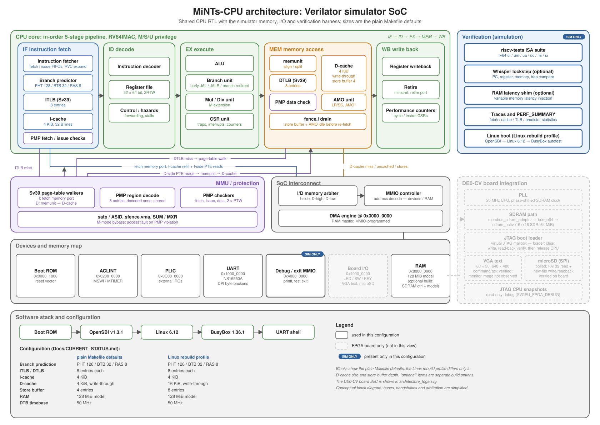

# MiNTs-CPU

**A SystemVerilog RV64IMAC RISC-V CPU/SoC that boots Linux on a DE0-CV FPGA.**

MiNTs-CPU runs OpenSBI, Linux 6.12 and a static BusyBox userspace on the
Terasic DE0-CV, with an interactive shell over a physical UART. The validated
board configuration runs at **20 MHz with 64 MiB SDRAM**. The build workflow
was exercised on an **Apple M1 Mac**, using Docker for Linux and Quartus builds
and native macOS tools for USB-Blaster programming.

The project builds on the [cpu.kanataso.net teaching CPU material](https://cpu.kanataso.net/).
It includes M/S/U privilege modes, Sv39 virtual memory, PMP, instruction/data
caches, interrupt controllers, a custom SDRAM controller, and a verified JTAG
RAM loader. This is a prototype with a defined validation scope, not a
certified RISC-V implementation or a general-purpose Linux distribution.

**Start here:** [DE0-CV Linux guide / 実機起動ガイド](fpga/de0-cv/soc/README.md)
 · [Current status](Docs/CURRENT_STATUS.md)
 · [Documentation index](Docs/README.md)

## What runs

```text
DE0-CV FPGA
  → MiNTs RV64IMAC CPU + 64 MiB SDRAM
  → OpenSBI v1.3.1
  → Linux 6.12
  → BusyBox 1.36.1 initramfs
  → interactive UART shell
```

Physical-board checks cover continued UART commands, file creation/readback/
removal, a CPU loop, 1 MiB of zero-data processing, sleep and response after
an idle interval. The kernel uses the normal `riscv_clocksource`, with 100 Hz
periodic scheduler ticks. The CPU and hardware timer remain at 20 MHz;
there is no `clocksource=jiffies` override.

The FPGA implementation uses **17,269 / 18,480 ALMs (93%)** and passes
setup, hold, recovery and removal checks at all four timing corners at
20 MHz. Worst setup slack is **+2.168 ns**. This establishes the tested
20 MHz operating point, not a measured maximum frequency.

Verilator also boots Linux through `BUSYBOX-TEST-PASS`. Separate historical
Whisper lockstep runs compared over 61 million architectural instructions
through that autotest. Those results belong to their simulation configuration;
lockstep was not rerun for the final FPGA configuration.
See [test scope and limitations](Docs/TEST_STATUS.md).

## Simulator and FPGA configurations

These are selected operating profiles, not maximum supported capacities.

| Parameter | Linux simulator rebuild profile | Validated DE0-CV profile |
|---|---:|---:|
| RAM | 128 MiB simulated RAM | 64 MiB physical SDRAM |
| I-cache | 4 KiB | 1 KiB |
| D-cache | 16 KiB | 1 KiB |
| Cache line | 32 B | 32 B |
| Store buffer | 8 entries | 4 entries |
| ITLB / DTLB | 8 entries each | 2 entries each |
| Branch prediction | Enabled | Disabled |
| D-cache policy | Write-through | Write-through |
| Hardware timebase in DTB | 50 MHz | 20 MHz |
| Linux entry point | BusyBox autotest | Interactive BusyBox shell |

The simulator profile is selected by `tools/rebuild-linux.sh`; plain Makefile
defaults differ (4 KiB D-cache and a four-entry store buffer). The smaller
FPGA profile fits the board's logic and routing budget. No controlled benchmark
yet quantifies the performance difference between these profiles. Simulated
CPI, simulator wall time and physical FPGA frequency are different quantities.

## Build and run

### Linux in Verilator

With Docker Desktop running on Apple Silicon:

```sh
bash tools/rebuild-linux.sh all
bash tools/run-linux.sh
```

The first command builds dependencies and boot artifacts. The second runs the
simulator; success is `BUSYBOX-TEST-PASS`. See
[rebuilding and dependencies](Docs/REBUILD_FROM_CLEAN.md).

### Linux on DE0-CV

The board uses a 20 MHz CPU with 64 MiB SDRAM and an interactive UART shell.
See the [DE0-CV Linux guide](fpga/de0-cv/soc/README.md) for setup, wiring,
building and booting, and the [clean rebuild guide](Docs/REBUILD_FROM_CLEAN.md)
for dependencies and recovery.

## Applications and board I/O

[MiNTs Life](examples/life/README.md) is a C application validated on the
physical board. The board also supports [GPIO](examples/boardctl/README.md),
[VGA text output](fpga/de0-cv/vga/README.md), and [microSD storage](fpga/de0-cv/sd/README.md).
The VGA command path has been tested, but monitor output has not been visually
checked. The SD card is additional storage; Linux currently boots from an image
loaded over JTAG. See the linked guides for commands and validation boundaries.

## Architecture and sources

The two conceptual block diagrams below share one layout; buses, handshakes and
arbitration are simplified, so they do not show every RTL connection.

- **Verilator simulator SoC:** the shared CPU RTL with the simulator's RAM
  model, DPI UART backend, debug/exit MMIO and verification harness. Block sizes
  are the plain Makefile defaults; the Linux rebuild profile (16 KiB D-cache,
  8-entry store buffer) is listed separately.
- **DE0-CV board SoC:** the same CPU RTL with board sizes, plus board-specific
  additions and replacements: PLL, SDRAM path (replacing the RAM model), JTAG
  boot loader, physical UART PHY, and board I/O with VGA text and microSD in the
  `0x4000_0000` window. Greyed blocks are not used on the board. The VGA path is
  verified on hardware through its command/acknowledgement interface; monitor
  output has not been observed.




Both diagrams are generated by `python3 tools/draw-architecture.py`.

| Location | Contents |
|---|---|
| `src/` | CPU pipeline, CSRs/PMP, execution units, simulation SoC/peripherals |
| `rtl/cache/`, `rtl/mmu/` | Cache arrays/controllers and translation logic |
| `rtl/bus/`, `rtl/peripheral/` | SDRAM bus adapter and physical 16550 UART integration |
| `fpga/de0-cv/` | Board tops, PLL, SDRAM controller, UART PHY, JTAG loader and RAM primitive |
| `platform/` | Boot ROM, device trees and Linux configuration fragments |
| `tb/`, `core/test/` | Simulation harnesses, unit tests and bare-metal programs |
| `tools/` | Rebuild, programming, regression and analysis tools |

See [RTL layout](Docs/RTL_LAYOUT.md) for exact source paths.

## Scope

- RV64IMAC, M/S/U privilege, Sv39, eight PMP entries, ACLINT and PLIC-compatible interrupts.
- Static userspace must use RV64IMAC / LP64; prebuilt floating-point ABI binaries are unsuitable.
- F/D, vector execution, SMP/cache coherence and full RVA23 compliance are not claimed.
- The root filesystem and `/tmp` are RAM-based. microSD FAT32 reads and a new-file write/remount/readback are verified; power-loss durability, networking and a graphical console remain unvalidated.
- Long-duration stability, 250 Hz board operation and higher FPGA frequencies are not established by the current tests.
- The board uses a write-through D-cache. Experimental write-back support is not the validated baseline.

## Documentation and attribution

- [Current status and profile comparison](Docs/CURRENT_STATUS.md)
- [Verification results and boundaries](Docs/TEST_STATUS.md)
- [Linux setup](Docs/LINUX_SETUP.md) and [clean rebuild](Docs/REBUILD_FROM_CLEAN.md)
- [Performance counters](Docs/PERFORMANCE_COUNTERS.md) and [historical simulation baseline](Docs/LINUX_BASELINE.md)
- [Complete documentation index](Docs/README.md)
- [BSD 3-Clause license](LICENSE) and [copyright / third-party notices](NOTICE)

Copyright (c) 2026, MiNTs Co., Ltd. (MiNTs株式会社). The project's original
contributions are available under the [BSD 3-Clause license](LICENSE), except
where a file or component specifies otherwise. Textbook-derived portions retain
Kanata Abe's copyright notice and BSD 3-Clause terms.
`tools/prepare-board-linux.py` remains GPL-2.0-only; external dependencies and
other third-party material retain their respective licenses. See [NOTICE](NOTICE).

[Tenstorrent Whisper](https://github.com/tenstorrent/whisper) is an optional
architectural reference for simulation lockstep and is licensed under Apache 2.0.
External source trees retain their own licenses. Proprietary Quartus installers,
build outputs and local development records are not distributed in this repository.
