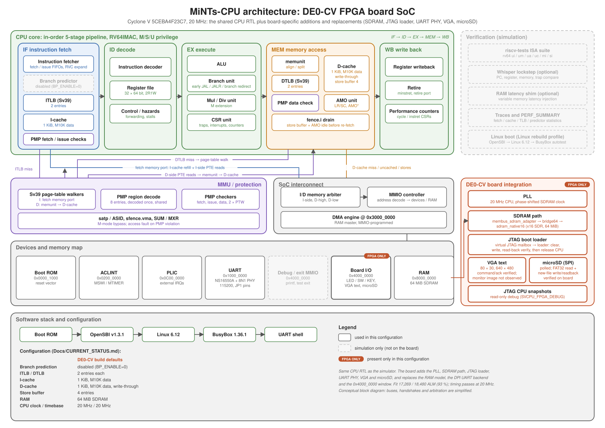

# MiNTs-CPU

**MiNTs-CPU is an experimental RV64IMAC RISC-V CPU and SoC written in SystemVerilog.**
It implements an in-order CPU with M/S/U privilege modes, Sv39 virtual memory,
PMP, instruction and data caches, a store buffer, branch prediction, interrupt
controllers and a UART. It builds on the
[cpu.kanataso.net teaching CPU material](https://cpu.kanataso.net/).

The project boots OpenSBI, Linux 6.12 and BusyBox in Verilator. It also runs
Linux with an interactive UART shell on a physical DE0-CV FPGA.

## Architecture

This conceptual diagram shows the simulator SoC and shared CPU architecture.
Buses, handshakes and arbitration are simplified. The diagram uses plain
Makefile defaults; the Linux simulation build uses a 16 KiB D-cache and an
8-entry store buffer instead of the default 4 KiB and 4 entries.


The FPGA build uses the same CPU RTL with a smaller configuration and adds
board-specific memory and I/O. See the [FPGA architecture diagram](Docs/images/architecture_fpga.svg)
and [configuration comparison](Docs/CURRENT_STATUS.md#configuration-comparison).
Both diagrams can be regenerated with `python3 tools/draw-architecture.py`.
For source organization, see [RTL layout](Docs/RTL_LAYOUT.md).

| Component | Role |
|---|---|
| CPU pipeline | In-order instruction fetch, decode, execute, memory and writeback; integer, multiply/divide, atomic and compressed instructions |
| Memory system | Configurable I/D caches, a write-through data path and store buffer |
| Virtual memory | Sv39 instruction/data TLBs and page-table walkers |
| Privileged architecture | M/S/U modes, CSRs, traps, interrupts and PMP physical access checks |
| Frontend | Branch prediction with PHT, BTB and return-address stack when enabled |
| SoC peripherals | ACLINT timer/software interrupts, PLIC-compatible external interrupts, UART and DMA |

These are configurable implementation features; see the diagram and profile
table below for the settings used by the two Linux environments.

## Verification

- **Linux simulation:** Verilator boots OpenSBI, Linux and BusyBox through
  `BUSYBOX-TEST-PASS`.
- **Architectural comparison:** historical Whisper lockstep runs compared over
  61 million committed instructions through the BusyBox autotest. This was a
  simulation configuration, not the final FPGA profile.
- **DE0-CV hardware:** Linux and BusyBox run at 20 MHz with 64 MiB SDRAM;
  UART interaction, file operations, CPU load and sleep/resume were exercised.

These are prototype results, not a claim of complete RISC-V certification or
production readiness. See [verification results and limitations](Docs/TEST_STATUS.md).

## Performance checkpoint

A historical Verilator run of the Linux BusyBox command-loop workload measured
**CPI 2.376** (IPC approximately 0.420): 42,079,566 instructions retired over
100 million simulated cycles. This window includes Linux boot and uses a 16 KiB
write-through D-cache with an 8-entry store buffer. An earlier checkpoint under
the same workload recorded CPI 2.393. These are simulation measurements for
comparing changes, not results for the DE0-CV FPGA configuration.

See [Linux performance baseline](Docs/LINUX_BASELINE.md) for the workload,
configuration and measurement limits, and [performance counters](Docs/PERFORMANCE_COUNTERS.md)
for simulator instrumentation.

## Simulator and FPGA profiles

The table compares the Linux simulator rebuild profile with the validated board
profile. They are selected configurations, not the maximum capacities of the RTL.

| Parameter | Linux simulator rebuild | DE0-CV FPGA |
|---|---:|---:|
| RAM | 128 MiB simulated | 64 MiB SDRAM |
| I-cache / D-cache | 4 KiB / 16 KiB | 1 KiB / 1 KiB |
| Cache line | 32 B | 32 B |
| Store buffer | 8 entries | 4 entries |
| ITLB / DTLB | 8 entries each | 2 entries each |
| Branch prediction | Enabled | Disabled |
| D-cache policy | Write-through | Write-through |
| Hardware timer timebase | 50 MHz | 20 MHz |
| Linux userspace | BusyBox autotest | Interactive BusyBox shell |

The plain Makefile defaults differ from the Linux simulator rebuild profile.
No controlled benchmark has yet quantified the performance difference between
these profiles. See [current status](Docs/CURRENT_STATUS.md) for details.

## Run in Verilator

With Docker Desktop running on Apple Silicon:

```sh
bash tools/rebuild-linux.sh all
bash tools/run-linux.sh
```

The first command builds the required artifacts; the second runs the simulation.
See [clean rebuild and dependencies](Docs/REBUILD_FROM_CLEAN.md).

## FPGA implementation

The DE0-CV profile uses 1 KiB instruction and data caches, two entries per TLB,
and disabled branch prediction. Its physical implementation passed timing at
20 MHz and used 17,269 / 18,480 ALMs. The tested build passed setup, hold,
recovery and removal checks at all four timing corners, with worst setup slack
of +2.168 ns. This is a validated operating point, not a measured maximum frequency.

The board adds a physical UART, SDRAM controller, JTAG loader and board I/O.
The following diagram uses the same layout as the simulator view so the shared
and board-specific parts can be compared.



VGA command acknowledgement and microSD file read/write were exercised; VGA
monitor output, SD boot and long-duration stability remain unverified.

[**DE0-CV Linux guide →**](fpga/de0-cv/soc/README.md)

Additional details: [current status and profile comparison](Docs/CURRENT_STATUS.md),
[MiNTs Life](examples/life/README.md), [GPIO](examples/boardctl/README.md),
[VGA](fpga/de0-cv/vga/README.md), and [microSD](fpga/de0-cv/sd/README.md).

## Scope and limitations

The validated userspace uses static RV64IMAC / LP64 binaries. Floating-point
F/D, vector execution, SMP/cache coherence and full RVA23 compliance are not
claimed. The board root filesystem is a RAM-based initramfs; microSD is additional
storage. Long-duration stability and 250 Hz board operation are not established.
Experimental write-back cache support is outside the validated board profile.

## Documentation and license

- [Documentation index](Docs/README.md)
- [Linux setup](Docs/LINUX_SETUP.md) and [clean rebuild](Docs/REBUILD_FROM_CLEAN.md)
- [Performance counters](Docs/PERFORMANCE_COUNTERS.md) and [simulation baseline](Docs/LINUX_BASELINE.md)
- [BSD 3-Clause license](LICENSE) and [copyright / third-party notices](NOTICE)

Copyright (c) 2026, MiNTs Co., Ltd. The project's original
contributions are available under the [BSD 3-Clause license](LICENSE), except
where a file or component specifies otherwise. Textbook-derived portions retain
Kanata Abe's copyright notice and BSD 3-Clause terms.
`tools/prepare-board-linux.py` remains GPL-2.0-only; external dependencies and
other third-party material retain their respective licenses. See [NOTICE](NOTICE).

[Tenstorrent Whisper](https://github.com/tenstorrent/whisper) is an optional
architectural reference licensed under Apache 2.0. External source trees retain
their own licenses. Proprietary Quartus installers, build outputs and local
development records are not distributed in this repository.
